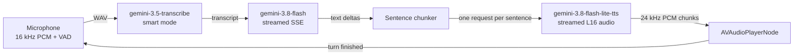

# Gemini Voice: Low-Latency STT → LLM → TTS Voice Agent for iOS

A hands-free SwiftUI voice assistant that chains three Gemini models into a streaming speech pipeline. You talk, Gemini transcribes, thinks, and answers out loud, sentence by sentence, while the reply is still being generated.

No third-party dependencies: everything runs on `AVFoundation`, `URLSession`, and the Gemini Interactions REST API.

## Pipeline



| Stage | Model | Endpoint | Notes |
|---|---|---|---|
| Speech-to-text | `gemini-3.5-transcribe` | `POST /v1beta/interactions` | Inline WAV audio, `transcription_config.mode = "smart"` removes filler words and formats numbers |
| Language model | `gemini-3.8-flash` (default) | `POST /v1beta/interactions?alt=sse` | `thinking_level: "low"`, conversation state kept server-side via `previous_interaction_id` |
| Text-to-speech | `gemini-3.8-flash-lite-tts` (default) | `POST /v1beta/interactions?alt=sse` | `response_format: audio/l16 @ 24 kHz`, `stream: true`, prebuilt voice (default `Kore`) |

The language model and TTS model can be changed in Settings. Options are defined in `Pipeline/GeminiModels.swift`.

## How latency is kept low

1. **Endpointing on device.** Energy-based voice activity detection with an adaptive noise floor ends the utterance after ~0.7 s of silence, so there's no server round trip to decide you've stopped talking. You can also tap the orb to send immediately.
2. **Small uploads.** Audio is downsampled to 16 kHz mono, trimmed to 0.4 s of pre-roll before speech and ~0.2 s of trailing silence.
3. **Warm connection.** Starting a session issues a cheap `GET /models/{model}` that validates the API key and opens the TLS/HTTP/2 connection. All stages share one `URLSession`.
4. **Streaming LLM.** Text deltas are parsed from server-sent events as they arrive.
5. **Sentence-level TTS fan-out.** `SentenceChunker` emits a segment at each sentence boundary (the first segment may break at a clause after 40 characters). Each segment immediately gets its own streaming TTS request, so later sentences synthesize while earlier ones play.
6. **Streamed audio playback.** Raw PCM chunks are scheduled on `AVAudioPlayerNode` the moment they arrive, strictly in sentence order, without waiting for a full file.
7. **Minimal thinking.** The LLM runs at the lowest thinking level the model supports (`low` for 3.8 Flash, `minimal` for older Flash models).

### Measured latency (October 2026, single requests from the Mac)

| Step | Result |
|---|---|
| Transcribe a 5 s clip | ~1.2 s |
| LLM first token, `gemini-3.8-flash` | ~4.0 s |
| LLM first token, `gemini-3.5-flash-lite` | ~2.6 s |
| TTS first audio chunk, `gemini-3.8-flash-lite-tts` | ~0.55 s |

The LLM is the dominant cost. Expect roughly 5–6 s from end of speech to first audio with 3.8 Flash, and about 1.5 s less with 3.5 Flash-Lite. The app shows live per-turn numbers (Transcribe, First token, Voice to voice) under the orb.

## Using the app

1. Add a Gemini API key (see Setup).
2. Tap **Start Conversation** and grant microphone access.
3. Speak naturally. The orb tracks your voice level and changes color by phase: blue (listening), indigo (transcribing), purple (thinking), teal (speaking).
4. Tap the orb to send early while listening, or to interrupt Gemini while it is transcribing, thinking, or speaking. Interrupted replies are marked in the transcript.
5. After Gemini finishes speaking, it listens again automatically. The session ends after ~30 s with no speech, or when you tap **End Conversation**.
6. Use the compose button in the toolbar to start a new conversation (clears the transcript and server-side context).

## Setup

**Requirements:** Xcode 27, iOS 27 (device or iOS 27 simulator). The target also builds for macOS 27.

Provide an API key from [Google AI Studio](https://aistudio.google.com/apikey) in either of two ways:

- **In the app:** Settings → Gemini API Key → paste and save. The key is stored in the Keychain (`kSecAttrAccessibleAfterFirstUnlockThisDeviceOnly`).
- **In Xcode:** Product → Scheme → Edit Scheme → Run → Arguments → Environment Variables → add `GEMINI_API_KEY`. This takes precedence over the Keychain.

> The key is sent directly from the device to the Gemini API. That's fine for a demo or personal app; for a shipped product, proxy requests through your own backend so the key never lives on the client.

Build settings added to the target:

- `INFOPLIST_KEY_NSMicrophoneUsageDescription`
- `ENABLE_OUTGOING_NETWORK_CONNECTIONS = YES` and `ENABLE_RESOURCE_ACCESS_AUDIO_INPUT = YES` (macOS App Sandbox)

## Project structure

```
GeminiSTTLLMTTS/
├── MyApp.swift                    App entry point
├── ContentView.swift              Main screen: transcript, orb, status, latency, controls
├── Agent/
│   ├── VoiceAgent.swift           @Observable conversation loop, interruption, metrics, audio session
│   ├── SentenceChunker.swift      Splits streamed text into speakable segments; strips markdown
│   └── APIKeyStore.swift          Environment variable / Keychain key resolution
├── Audio/
│   ├── MicrophoneCapture.swift    AVAudioEngine capture, 16 kHz conversion, VAD, WAV encoding
│   ├── PCMPlayer.swift            Gap-free streamed PCM playback, output level meter, idle waiting
│   └── AVAudioNode+Tap.swift      Throwing tap installation (iOS 27 API)
├── Pipeline/
│   ├── GeminiClient.swift         Interactions API: warm-up, transcribe, streamReply, streamSpeech
│   └── GeminiModels.swift         Model IDs, thinking levels, voice list
└── Views/
    ├── OrbView.swift              Animated, level-reactive orb (respects Reduce Motion)
    ├── TranscriptView.swift       Chat bubbles and empty state
    ├── LatencyView.swift          Per-turn latency readout
    └── SettingsView.swift         API key, voice, and model pickers
```

### Concurrency model

- `VoiceAgent` and all views are main-actor isolated (the target uses `SWIFT_DEFAULT_ACTOR_ISOLATION = MainActor`).
- `MicrophoneCapture`, `PCMPlayer`, and `GeminiClient` are `nonisolated` so realtime audio callbacks and network streams never hop through the main actor. Shared state in the audio classes is guarded by `NSLock`.
- Each turn runs in its own `Task`; interrupting cancels it, which cancels the in-flight URL requests and flushes queued audio. TTS requests run in detached tasks and feed per-sentence `AsyncThrowingStream`s that the playback loop consumes in order.

## Customizing

- **Persona and reply style:** edit `VoiceAgent.systemInstruction`. It currently asks for one to three short spoken sentences with no markdown.
- **Endpointing:** tune `MicrophoneCapture.VoiceActivity` (`endOfSpeechSilence`, `speechMarginDB`, `noSpeechTimeout`, and so on).
- **Chunking:** adjust `SentenceChunker.minimumSentenceLength`, `firstClauseLength`, and `maximumSegmentLength`.
- **Models and voices:** add entries to `GeminiModels.conversationOptions`, `speechOptions`, or `voices`.

## Limitations

- **No voice barge-in.** The microphone is off while Gemini speaks, so you interrupt by tapping the orb. Talking over the assistant would need acoustic echo cancellation (voice processing on the input node).
- **Turn-based STT.** Transcription starts after you finish speaking. `gemini-3.5-transcribe-live` over the Live API WebSocket could stream partial transcripts while you talk.
- **Interrupted replies aren't added to server-side context.** The next turn continues from the last completed interaction.
- **Any network or API error ends the session** and shows the error message above the controls.

## Troubleshooting

| Symptom | Cause |
|---|---|
| `HTTP 403 … reported as leaked` | Google revoked that key. Create a new one in AI Studio. |
| `HTTP 403/404` on a model | Your key doesn't have access to that model. Pick another in Settings. |
| "Microphone access is off" | Enable it in iOS Settings → Privacy & Security → Microphone. |
| Utterances end too early or never end | Adjust `VoiceActivity.endOfSpeechSilence` or `speechMarginDB` for your environment, or tap the orb to send. |
